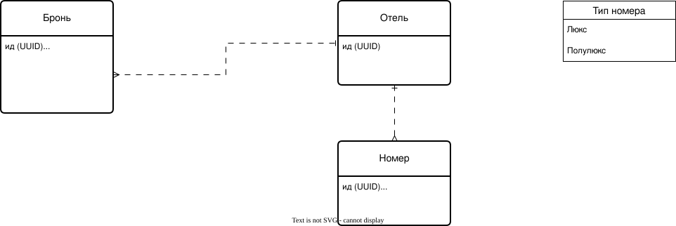
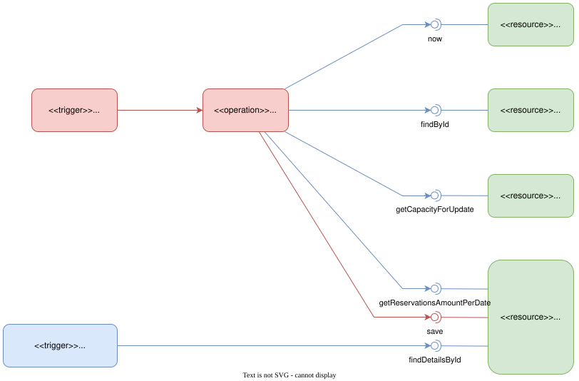
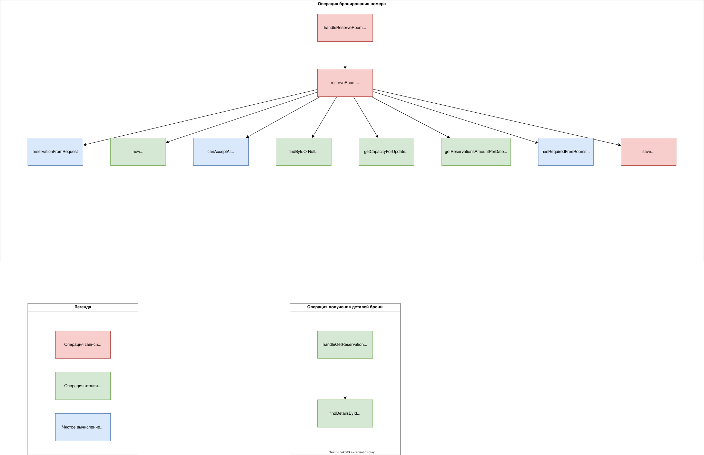

:toc: macro
:toc-levels: 3
:toc-title: Содержание
ifdef::env-github[]
:note-caption: :information_source:
endif::[]

= Project Mariotte

Проект Мариотт — это минималистичный демо-проект, иллюстрирующий применение основных идей https://ergowiki.azhidkov.pro/docs/about-ea/[Эргономичного подхода] на примере сервиса бронирования номеров в отелях.

toc::[]

== Карта проекта

В этом разделе собраны "Points of Interest" кодовой базы — ссылки на код, иллюстрирующий применение Эргономичного подхода или просто штуки, которые я считаю малоизвестными и полезными.

. Код, иллюстрирующий Эргономичный подход
.. Тестирование
... Тесты на поведение
+
+
link:src/test/kotlin/cases/app/reservations/ReserveRoomApiOpTest.kt[ReserveRoomApiOpTest]
... Эффективный запуск PostgreSQL для тестов
+
link:src/test/kotlin/infra/Postgres.kt[Postgres.kt]
... Доменно-специфичный матчер
+
link:src/test/kotlin/assertions/ReservationsMatchers.kt[ReservationMatchers.kt]
... Генерация случайных тестовых данных
+
link:src/test/kotlin/fixtures/object_mothers/RandomData.kt[RandomData.kt]
... ObjectMothers
+
link:src/test/kotlin/fixtures/object_mothers/HotelsObjectMother.kt[HotelsObjectMother]
+
link:src/test/kotlin/fixtures/object_mothers/ReservationsObjectMother.kt[ReservationsObjectMother]
+
link:src/test/kotlin/fixtures/object_mothers/RoomsObjectMother.kt[RoomsObjectMother]
... HTTP-клиенты ролей и API фич/ресурсов
+
link:src/test/kotlin/fixtures/clients/Guest.kt[Guest]
+
link:src/test/kotlin/fixtures/clients/apis/ReservationsHttpApi.kt[ReservationsHttpApi]
.. Неизменяемая модель данных
+
link:src/main/kotlin/mariotte/domain/rooms/Room.kt[Room]
+
link:src/main/kotlin/mariotte/domain/hotels/Hotel.kt[Hotel]
+
link:src/main/kotlin/mariotte/domain/reservations/Reservation.kt[Reservation]
.. Модель на базе диаграммы эффектов
... Простая операция
+
link:src/main/kotlin/mariotte/app/reservations/ReservationsController.kt#L74[ReservationsController:74]
... Сложная операция
+
link:src/main/kotlin/mariotte/app/reservations/ReserveRoomOp.kt[ReserveRoomOp]
... Простой ресурс
+
link:src/main/kotlin/mariotte/domain/hotels/HotelsRepo.kt[HotelsRepo]
+
link:src/main/kotlin/mariotte/domain/reservations/ReservationsRepo.kt[ReservationsRepo]
+
link:src/main/kotlin/mariotte/domain/rooms/RoomsRepo.kt[RoomsRepo]
.. Кодирование
... Обход проблемы интеграции Spring Transactions с Kotlin Result
+
В идеальном мире, операции должны явно возвращать результат в случае ошибок.
Однако стандартный механизм отката транзакций в Spring завязан на исключения и не учитывает Kotlin `Result` из стандартной библиотеки (а тащить ради этого Java-вый https://github.com/vavr-io/vavr[vavr] кажется оверкиллом).
+
Для того чтобы обойти эту проблему, я сейчас использую схему, когда операции выбрасывают ошибки исключениями (чтобы откатить транзакцию), а клиенты операций оборачивают их в `Result` с помощью `runCatching`.
+
link:src/main/kotlin/mariotte/app/reservations/ReserveRoomOp.kt[ReserveRoomOp]
+
link:src/main/kotlin/mariotte/app/reservations/ReservationsController.kt[ReservationsController]
... "Очевидизация" вариантов ответов эндпоинта
+
Я придерживаюсь мнения, что явное перечисление всех возможных исходов выполнения операции способствует пониманию кода и снижает вероятность внесения регрессий при его модификации.
Для этого я, с одной стороны, оборачиваю исключения в Result, а с другой стороны явно разбираю его на ожидаемые варианты в одном `when`-выражении.
+
link:src/main/kotlin/mariotte/app/reservations/ReservationsController.kt[ReservationsController]
. Прочие "Points of interest"
.. Верификация Json-схем
+
Для того чтобы переиспользовать продовые модели запросов и ответов и при этом обезопасится от поломки обратной совместимости API, я использую Json-схемы.
+
Для этого API фич в сигнатурах методов используют те же модели, что и продовые контроллеры, но внутри самостоятельно (де)сериализуют их в JSON-строки и верифицируют их на соответствие схемам.
+
link:src/test/resources/json-schemas/app/reservations/create-reservation.json[create-reservation.json]
+
link:src/test/kotlin/fixtures/clients/apis/ReservationsSchemas.kt[ReservationsSchemas]
+
link:src/test/kotlin/assertions/JsonBodyAssertions.kt[JsonBodyAssertions]
+
link:src/test/kotlin/fixtures/clients/apis/ReservationsHttpApi.kt[ReservationsHttpApi]
.. Problem Details В проекте используется тело ответа по стандарту https://datatracker.ietf.org/doc/html/rfc7807[Problem Details for HTTP APIs].
Но в стандарт почему-то входит момент времени возникновения ошибки, что, на мой взгляд, является очень полезной информацией.
+
Поэтому я завёл собственную обёртку, которая добавляет время в ответ - link:src/main/kotlin/mariotte/app/platform/spring/http/ErrorResponse.kt[ErrorResponse], и Spring-овый обработчик исключений - link:src/main/kotlin/mariotte/app/infra/UnhandledExceptionsHandler.kt[UnhandledExceptionsHandler], который собирает тела ответа этого типа.
.. PostgreSQL generate_series
+
SQL-запросы можно выполнять не только к таблицам и представлениям, но и к результатам выполнения некоторых функций, например https://postgrespro.ru/docs/postgrespro/16/functions-srf[generate_series].
+
link:src/main/kotlin/mariotte/domain/reservations/ReservationsRepo.kt[ReservationsRepo]
.. Kotlin value-класс
+
В Kotlin есть https://kotlinlang.org/docs/inline-classes.html[value classes] - легковесные обёртки вокруг других типов, которые могут выступать отличными доменно-специфичными типами.
+
И на удивление они почти хорошо поддерживаются и Spring Data Jdbc, и Jackson.
+
link:src/main/kotlin/mariotte/domain/reservations/ReservationPeriod.kt[ReservationPeriod]
+
link:src/main/kotlin/mariotte/domain/reservations/ReservationDetailsView.kt[ReservationDetailsView]
.. RepeatedTest
+
В JUnit есть возможность повторять тест-кейсы несколько раз, что может быть полезно для повышения надёжности недетерминированных тестов (тестов, включающих многопоточную работу).
+
link:src/test/kotlin/cases/app/reservations/ReserveRoomApiOpTest.kt[ReserveRoomApiOpTest]

== "Техническое задание"

* Сервис должен обеспечивать бронирования номеров в разных отелях;
* Сервис должен поддерживать типы номеров, определённых "международным стандартом" ISO 404:404 - люкс и полулюкс;
* Бронирование определяет только тип номера, но не конкретный номер.
Конкретный номер выбирает администратор при заселении гостя;
* Сервис должен исключать овербукинг — создание большего количества броней номеров определённого типа в одном отеле за определённую дату, чем есть в целом номеров данного типа в отеле;
* Сервис должен не допускать бронирования, начинающиеся ранее следующих суток относительно момента времени запроса на бронирование.

== Системная аналитика

=== Модель предметной области

=== Спецификация HTTP API

[NOTE]
====
Этот раздел написан в моём самодельном легковесном и слабо формализованном формате описания HTTP-эндпоинтов.

Маппинг ошибок на коды статусов выполнен в соответствии с https://ergowiki.azhidkov.pro/docs/patterns/http-json-api/status-code-choosing/[гайдлайном эргономичного подхода].
====

==== Модель RoomReservationRq

[source]
----
{
  "hotelId": <string:uuid>
  "roomType": <number>
  "email": <string:email>
  "from": <string:iso-8601 date>
  "period": <string:iso-8601 duration>
}
----

==== Модель ReservationSuccess

[source]
----
{
  "reservationId": <string:uuid>
}
----

==== Модель ReservationDetailsView

[source]
----
{
  "hotelRef": {
    "id": <string:uuid>
  }
  "roomType": <number>
  "email": <string:email>
  "from": <string:iso-8601 date>
  "period": <string:iso-8601 duration>
}
----

==== Модель ErrorResponse

Соответствует спецификации https://datatracker.ietf.org/doc/html/rfc7807[Problem Details for HTTP APIs], всегда содержит дополнительное свойство timestamp.

[source]
----
{
  "timestamp": <string:iso-8601 date-time>,
  "instance": <string:uri-reference>,
  "status": <number:100..599>,
  "type": <string:uri-reference>,
  "title": <string>,
  "detail": <string>
}
----

==== Метод reserveRoom

Метод бронирования номера в отеле на период.

Предусловия:

* Передан идентификатор отеля, существующий в БД;
* Передан корректный тип номера;
* В заданном отеле есть номера заданного типа;
* Переданная дата "от" находится в будущем, не менее чем на один день от момента поступления запроса;
* Длительность периода бронирования составляет не менее одного дня;
* В запрошенном отеле за каждый запрошенный день есть свободный номер запрошенного типа.

Постусловия:

* В БД в коллекцию бронирований добавлена бронь, соответствующая запросу;
* Количество доступных номеров указанного типа за указанный период уменьшено на 1.

[source]
----
POST /reservations
>
  <RoomReservationRq>

<
  201
    <ReservationSuccess>

  400
    <ErrorResponse> // некорректный запрос

  404
    <ErrorResponse:hotel-not-found> // отель с указанным идентификатором не найден

  404
    <ErrorResponse:room-type-not-found> // номер указанного типа в отеле с указанным идентификатором не найден

  409
    <ErrorResponse:no-available-rooms> // за запрошенные даты в отеле нет свободных комнат запрошенного типа

  422
    <ErrorResponse:reservation-dates-in-past> // до даты начала резервации осталось менее дня

  500
    <ErrorResponse> // при обработке запроса произошла неожиданная ошибка
----

==== Метод getReservationDetails

Метод просмотра информации о бронировании

Предусловия:

* Передан идентификатор существующей брони;

Постусловия:

* Возвращена информация о бронировании, соответствующая переданному идентификатору

[source]
----
GET /reservations/{reservationId}
>

<
  200
    <ReservationDetailsView>

  400
    <ErrorResponse> // некорректный запрос

  404
    <ErrorResponse:reservation-not-found> // бронь с указанным идентификатором не найдена

  500
    <ErrorResponse> // при обработке запроса произошла неожиданная ошибка
----

=== Диаграмма эффектов

[NOTE]
====
Здесь используется обновлённая и пока неописанная нотация https://azhidkov.pro/effects-diagram/landing/[Диаграммы эффектов]:

* Синие прямоугольники — операции чтения (cqs-query);
* Красные прямоугольники — операции записи (cqs-command);
* Зелёные прямоугольники — ресурсы;
* Синие "леденцы" — эффекты чтения ресурса;
* Красные "леденцы" — эффекты записи ресурса;
====

=== Структурная схема (Граф вызовов)

=== Структура пакетов

.Описание пакетов приложения.
|===
|Пакет |Описание

|mariotte
|Код, специфичный для данного приложения.

|mariotte.app
|Код приложений проекта.

Код слоя приложения (what the systed does в Lean Architecture) - точки входа в систему, сложные (составные) операции и конфигурация инфраструктуры, обеспечивающая работу точек входа.

|mariotte.app.reservations
|Код реализации операций над ресурсом Reservations (Бронирования).

|mariotte.app.infra
|Пакет инфраструктурных бинов приложения.

В любом пакете проекта может быть подпакет `infra`, который содержит определения инфраструктурных Spring-бинов (или их аналогов в других фреймворках),
обеспечивающих работу модуля родительского пакета.

В данном случае в этом пакете содержится бин, глобального обработчика ошибок, который рендерит ошибки в
виде ProblemDetails с timestamp-ом.

|mariotte.app.platform
|Библиотечный код, используемый только в слое приложения.

Эвристика для разделения инфраструктурного и библиотечного кода — количество и срок жизни экземпляров классов.
Если экземпляров создаётся немного и живут они долго — такие штуки идут в `infra`.
Если это статические (top-level) функции или определения классов, экземпляры которых создаются в больших количествах и живут миллисекунды - такой код идёт в `platform`.

|mariotte.app.platform.spring
|Библиотечный код, дополняющий проекты Spring.

У меня нет жёсткого гайдлайна по декомпозиции кода платформы, но в целом я стараюсь чтобы структура пакетов напоминала структуру пакетов дополняемого кода.

|mariotte.app.platform.spring.http
|Расширения классов в пакете `org.springframework.http`

|mariotte.domain
|Домен (ресурсы — сущности, агрегаты, объекты значения и репозитории) системы.

|mariotte.domain.hotels
|Пакет ресурса агрегата "Отель".

|mariotte.domain.reservations
|Пакет ресурса агрегата "Бронь".

|mariotte.domain.rooms
|Пакет ресурса агрегата "Номер".

|mariotte.domain.infra
|Пакет с инфраструктурными бинами (конвертерами класса Period в данном случае), обеспечивающими работу модулей домена.

|platform
|Универсальный код, который можно переиспользовать во множестве приложений.

Как вариант, его можно вынести в отдельную библиотеку, но, на мой взгляд, это создаст лишнюю сцепленность
между независимыми проектами, поэтому я обычно такой код копирую по мере необходимости.

|platform.domain.errors
|Фреймворк доменных ошибок, используемый всем прикладным кодом.

|platform.kotlin
|Расширения стандартной библиотеки Kotlin.

|platform.java.lang
|Расширения классов из пакета `java.lang`

|platform.postgres
|Расширения классов JDBC-драйвера PostgreSQL.

|platform.spring
|Расширения модулей Spring

|platform.spring.jdbc
|Расширения классов из пакета `org.springframework.jdbc`

|platform.spring.data
|Дополнения функциональности модуля Spring Data Commons

|===

== Требования к окружению

* JDK >=25
* Docker >=26.1.3

== Запуск тестов

[source,shell]
----
./gradlew test
----

== Сборка проекта

[source,shell]
----
./gradlew build
----

== Запуск проекта

[source,shell]
----
java -jar -Dspring.profiles.active=demo build/libs/project-mariotte-0.0.1-SNAPSHOT.jar
----

=== Примеры запросов

.Бронирование номера
[source,shell]
----
curl --url 'http://localhost:8080/reservations' \
     --header 'Content-Type: application/json' \
     --data-raw '{
        "hotelId": "0196f8b0-2b3c-7f12-8a45-1c2d3e4f5a6b",
        "roomType": 1,
        "from": "2026-06-14",
        "period": "p1d",
        "email": "test@azhidkov.pro"
     }'

----

.Запрос информации о брони
[source,shell]
----
curl --url 'http://localhost:8080/reservations/019c7f27-c24b-7073-96b1-8320cfd0b71e'
----
